# Plot Workbench 在线模板库

20 个可直接运行的 Matplotlib 模板，使用可复现的合成数据。无需固定函数，也无需联网绘图。

## 使用

1. 点击下方图片对应的 **Python 代码**。
2. 在 GitHub 代码页点击右上角 **复制原始文件 / Copy raw file** 图标，或打开 **原始文件 / Raw** 后复制全部内容。
3. 在 [Plot Workbench](https://github.com/pawafa666-eng/plot-workbench) 中打开 **模板库 → 新建模板**，粘贴代码，运行后保存。
4. 直接运行会使用合成数据；项目导入表格后，代码会使用工作台提供的 `data`（pandas.DataFrame）。按每个模板的参数要求排列列。

软件不自动下载或执行 GitHub 代码。使用前可以检查并修改模板。

## 模板

### 基础折线图

[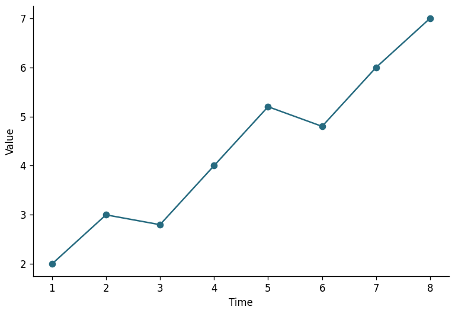](templates/line/line.py)

[Python 代码](templates/line/line.py) · 任意行，2 列数值：x、y。

### 阶梯图

[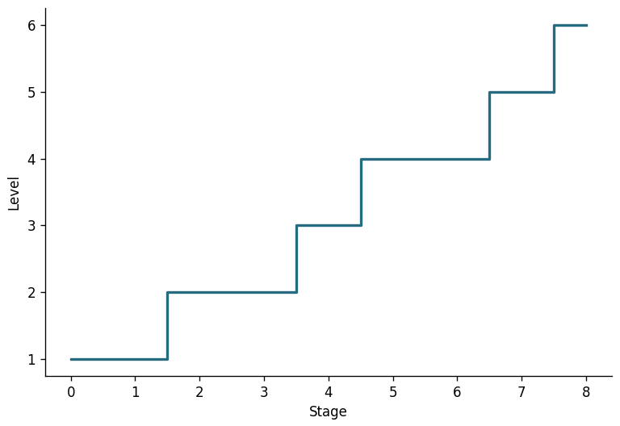](templates/line/step.py)

[Python 代码](templates/line/step.py) · 任意行，2 列数值：x、y。

### 面积图

[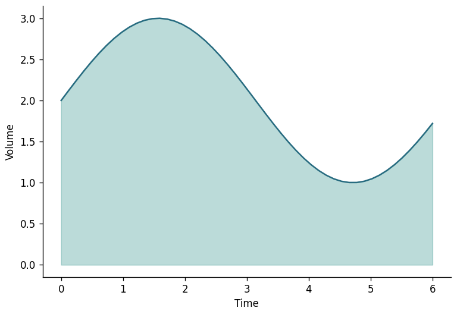](templates/line/area.py)

[Python 代码](templates/line/area.py) · 任意行，2 列数值：x、y。

### 误差棒图

[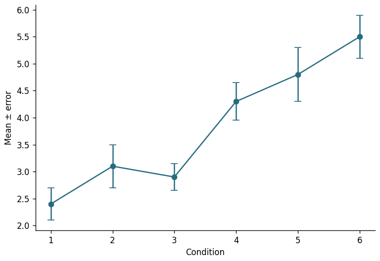](templates/line/errorbar.py)

[Python 代码](templates/line/errorbar.py) · 任意行，3 列数值：x、均值、非负误差。

### 置信区间带

[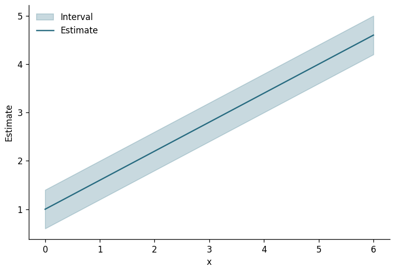](templates/line/confidence_band.py)

[Python 代码](templates/line/confidence_band.py) · 任意行，4 列数值：x、中心值、下界、上界。

### 柱状图

[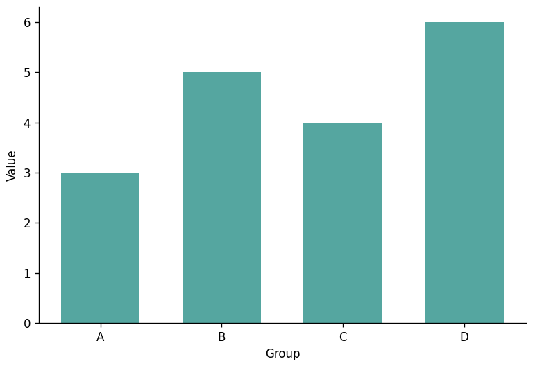](templates/bar/bar.py)

[Python 代码](templates/bar/bar.py) · 任意行，2 列：类别、数值。

### 水平柱状图

[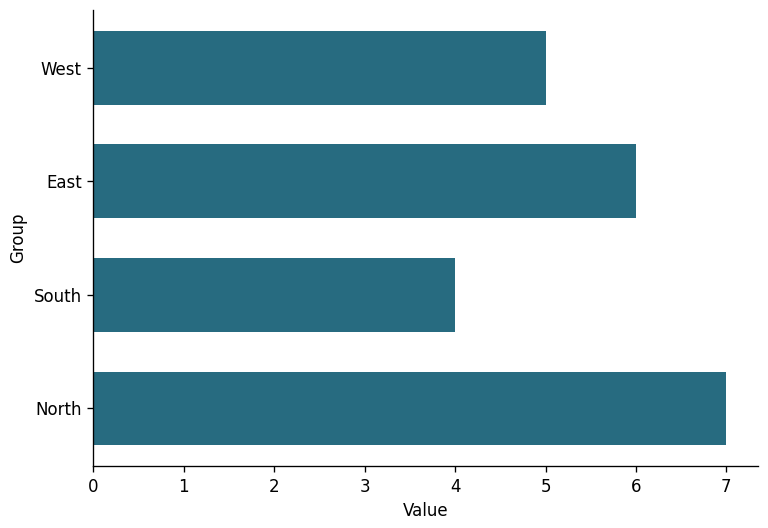](templates/bar/horizontal_bar.py)

[Python 代码](templates/bar/horizontal_bar.py) · 任意行，2 列：类别、数值。

### 分组柱状图

[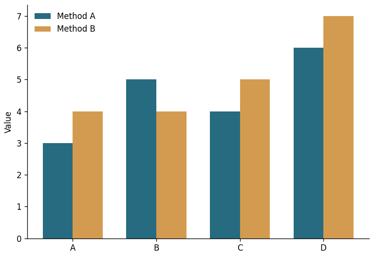](templates/bar/grouped_bar.py)

[Python 代码](templates/bar/grouped_bar.py) · 任意行，3 列：类别、序列 A、序列 B。

### 堆叠柱状图

[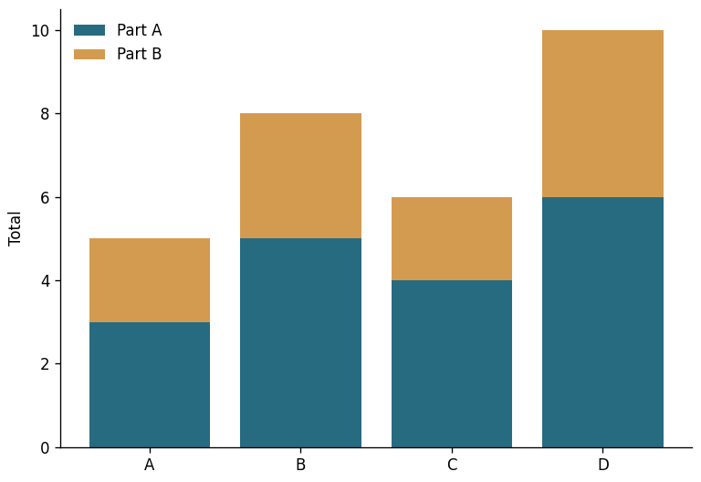](templates/bar/stacked_bar.py)

[Python 代码](templates/bar/stacked_bar.py) · 任意行，3 列：类别、部分 A、部分 B（通常非负）。

### 棒棒糖图

[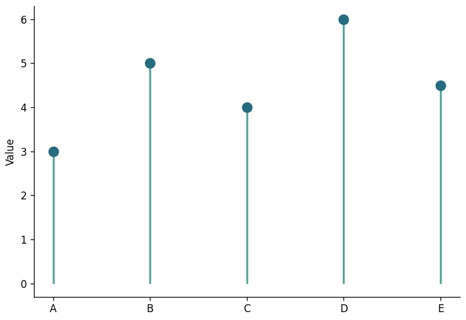](templates/bar/lollipop.py)

[Python 代码](templates/bar/lollipop.py) · 任意行，2 列：类别、数值。

### 散点图

[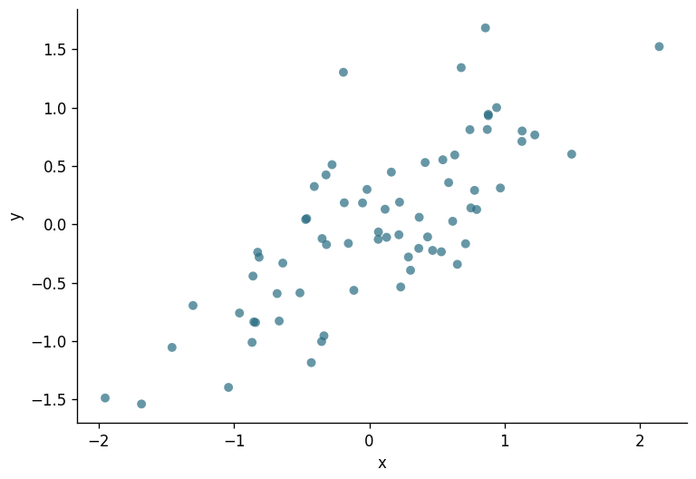](templates/scatter/scatter.py)

[Python 代码](templates/scatter/scatter.py) · 任意行，2 列数值：x、y。

### 气泡图

[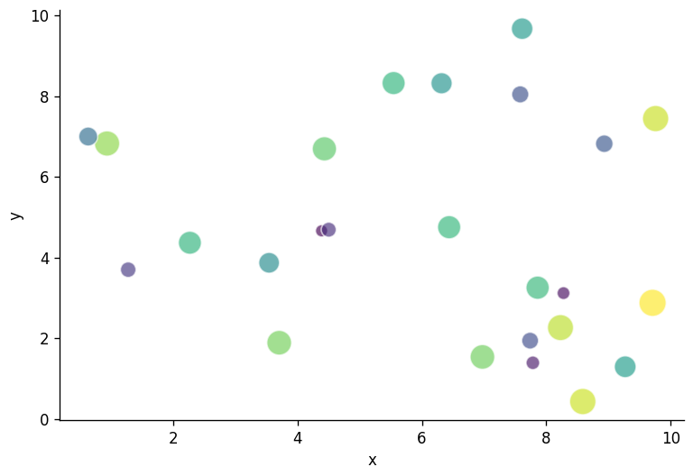](templates/scatter/bubble.py)

[Python 代码](templates/scatter/bubble.py) · 任意行，3 列数值：x、y、气泡大小。

### 线性拟合图

[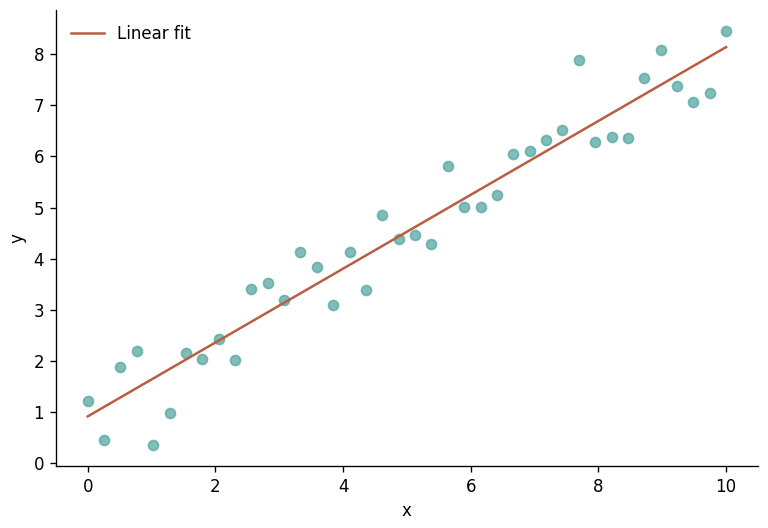](templates/scatter/regression.py)

[Python 代码](templates/scatter/regression.py) · 至少 2 行、2 列数值：x、y；x 不可全部相同。

### 直方图

[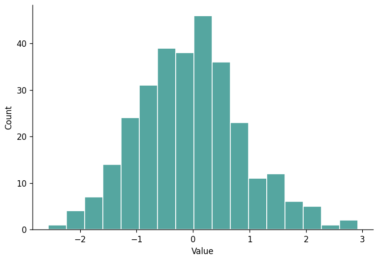](templates/distribution/histogram.py)

[Python 代码](templates/distribution/histogram.py) · 至少 1 行、1 列数值：样本。

### 箱线图

[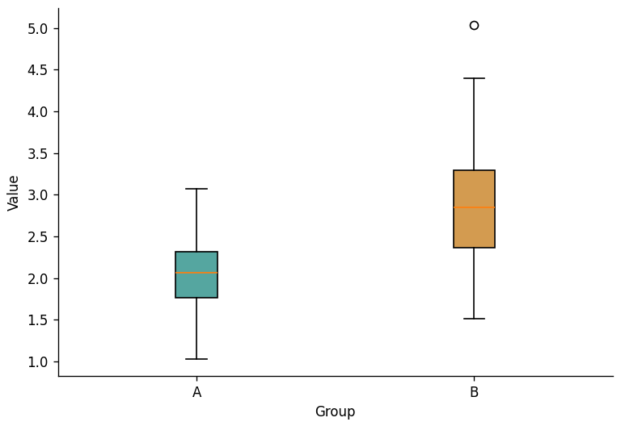](templates/distribution/boxplot.py)

[Python 代码](templates/distribution/boxplot.py) · 至少 2 行、2 列数值：两组等长样本。

### 小提琴图

[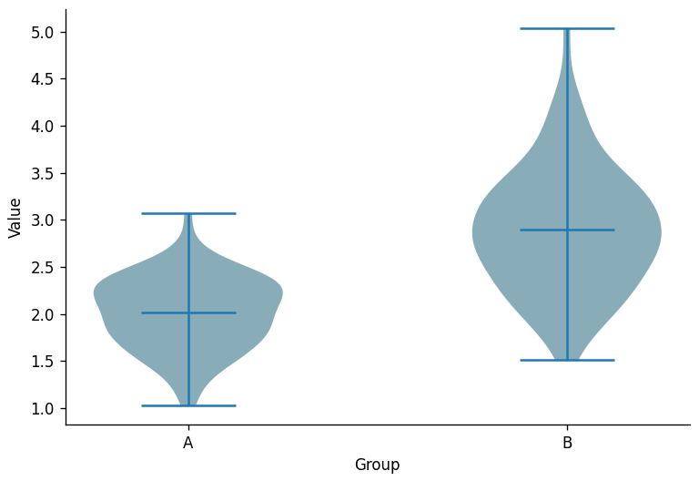](templates/distribution/violin.py)

[Python 代码](templates/distribution/violin.py) · 至少 2 行、2 列数值：两组样本，各组应有变化。

### 经验累积分布

[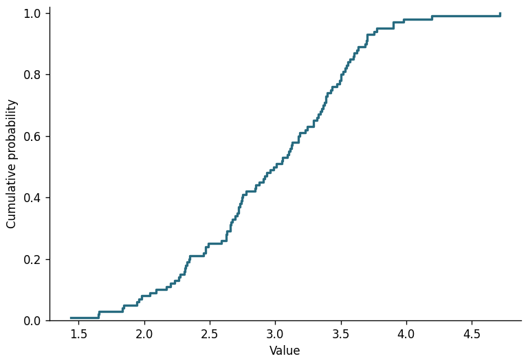](templates/distribution/ecdf.py)

[Python 代码](templates/distribution/ecdf.py) · 至少 1 行、1 列数值：样本。

### 矩阵热力图

[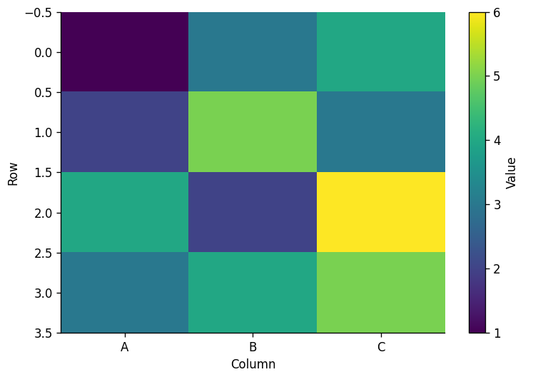](templates/heatmap/heatmap.py)

[Python 代码](templates/heatmap/heatmap.py) · 任意行，固定 3 列数值矩阵（可自行修改列数）。

### 相关系数矩阵

[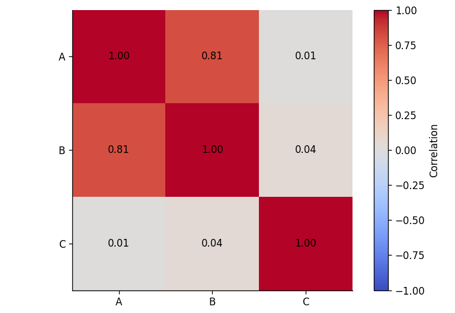](templates/heatmap/correlation.py)

[Python 代码](templates/heatmap/correlation.py) · 至少 3 行、3 列数值：三个变量，各列不可为常数。

### 三维散点图

[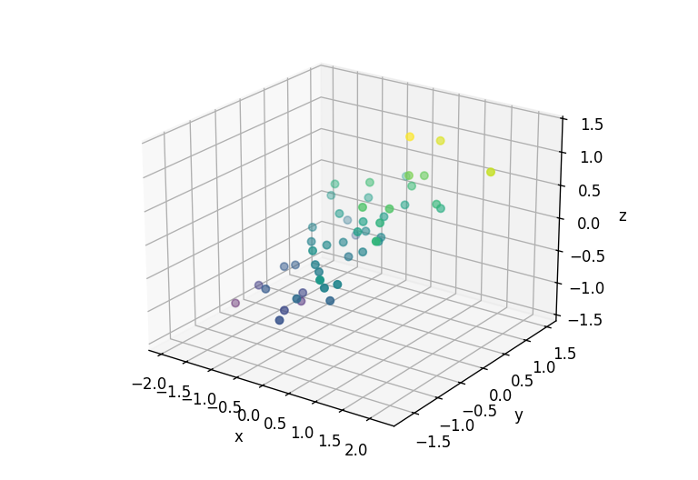](templates/three-dimensional/scatter_3d.py)

[Python 代码](templates/three-dimensional/scatter_3d.py) · 任意行，3 列数值：x、y、z。

## 验证与贡献

安装 requirements.txt 后运行 `python scripts/verify_gallery.py`，验证 20 个模板分别在独立进程运行，检查默认示例可复现、导入表格可用及预览不为空。
使用 `python scripts/verify_gallery.py --write` 更新预览。

欢迎通过 Pull Request 提交模板。请提供可运行的 Python 文件、合成示例、行列及类型要求、预览图，并更新 catalog.json 和 scripts/data_cases.json。不要上传个人数据、私有路径或未获授权的代码。

## 许可

模板、文档及预览按 AGPL-3.0-only 发布，详见 LICENSE。Plot Workbench 是 Tavotto v0.18.0 的派生项目；本库模板独立编写，预览均由合成数据生成。Tavotto 上游：https://github.com/Tavotto/Tavotto。
